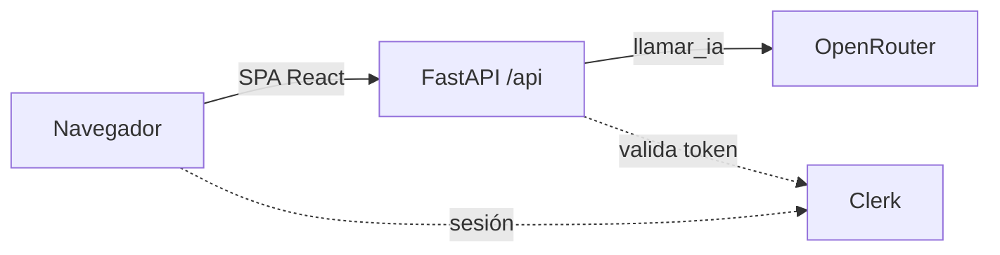

# ESPA · Práctica 1 — Resumidor con IA desplegado en Vercel y AWS EC2

Miniapp que resume un texto con IA. Se despliega de dos formas: serverless en Vercel (Parte 1) y en un contenedor Docker sobre AWS EC2 (Parte 2), con autenticación Clerk en ambas.

> Estado: **Fases 0, 1 y 2 integradas en `dev`** (SPA y proxy de Javier) (backend y verificación de Nicolas; tests, dependencias fijadas y variables de Pablo) y **Fase 5 hecha por Pablo** (`Dockerfile` multi-stage + verificación local del contenedor). Pendientes: Vercel (Fase 3, Javier), Clerk (Fase 4) y EC2 (Fase 6). Las secciones marcadas _Pendiente_ se rellenan en la fase indicada, en la misma rama que el cambio que documentan.

## 1. Identificación

| Persona | Rol | Aportación |
| --- | --- | --- |
| Pablo | A · Tests y seguridad | Fase 1: `api/test_api.py` (6 tests del contrato, proveedor simulado) y comprobación de que no se filtran detalles del proveedor; Fase 2: `requirements.txt` con versiones fijadas y tabla de variables completada; Fase 5: `Dockerfile` multi-stage, `docker_app.py`, `.dockerignore` y verificación local del contenedor (§1, §4, §5, §8, §10, §12); _Fase 3–4 y 6–7 pendientes_ |
| Javier | B · Frontend y Vercel (integrador) | Fase 0: scaffold del proyecto, flujo Git y README esqueleto; Fase 2: SPA React (`src/App.tsx`: formulario, carga, error y resultado) y proxy de Vite (§4, §10, §11, §12); integración de las ramas en `dev`; _Fase 3–4 y 6–7 pendientes_ |
| Nicolas | C · Backend, infra y AWS | Fase 1: backend FastAPI en `api/index.py` (`GET /api/health`, `POST /api/generar` validado 1–2000, `llamar_ia` aislada con timeout de 20 s y errores 502/504 sin trazas); verificación real en §10, corrección de `AI_MODEL` en §11 e integración de las ramas de Fase 1 en `dev`; _resto pendiente_ |

- Práctica: UD1 · Explotación y despliegue de una aplicación con IA.
- Miniapp: **Resumidor** (texto de 1 a 2000 caracteres → resumen breve).
- Las aportaciones individuales se pueden comprobar en `git log --format='%an %s'` (los merges no son squash).

## 2. Plan de documentación

- **Lector:** alguien con conocimientos de Docker y cloud que quiere reproducir el despliegue sin hablar con nosotros.
- **Estructura:** las 12 secciones del enunciado en un único README; capturas en `evidencias/` con nombre `fase-N_que-demuestra.png`.
- **Reparto:** documentamos todos. Cada uno escribe lo que hace en la sección que corresponda, en la rama de la tarea que documenta.
- **Actualización:** por hitos. Cada fase deja su sección escrita antes de mergear a `dev`; no se reconstruye al final.
- **Guía consultada:** [Diátaxis](https://diataxis.fr/) (separar instrucciones, referencia y explicación).

## 3. Arquitectura

_Pendiente (Fase 2–3)._ Esquema previsto:



- Vercel: SPA estática + función serverless Python en `api/index.py`.
- EC2: un único contenedor; FastAPI sirve la API y `dist/`.

## 4. Requisitos e instalación local

Versiones con las que se ha creado el proyecto:

| Herramienta | Versión |
| --- | --- |
| Node.js | 26.11 |
| pnpm | 11.28 |
| Python | 3.14 (local); 3.12 en el contenedor |
| Vite / React / TypeScript | 8.3 / 19.2 / 6.0 |
| Tailwind CSS | 4.3 (plugin `@tailwindcss/vite`) |
| Clerk (frontend) | `@clerk/react` 6.17 |
| pytest · httpx | 9.1.1 · 0.28.1 (tests del contrato de la API) |

Las dependencias de Python están **fijadas con `==` en `requirements.txt`** (Fase 2) para que el mismo código instale lo mismo en local, en Vercel y en la imagen de Docker. Para actualizar una versión: `pip install -U <paquete>`, comprobar `pytest -q` y cambiar la línea correspondiente.

Frontend:

```bash
pnpm install
cp .env.example .env     # rellenar a mano
pnpm dev                 # http://localhost:5173
pnpm build               # comprobación: debe terminar sin errores
```

Backend (Fase 1):

```bash
python -m venv .venv && source .venv/bin/activate   # fish: activate.fish
pip install -r requirements.txt
uvicorn api.index:app --reload --port 8000
```

Tests (Python 3.14 local, `pytest` + `httpx` instalados con `pip install -r requirements.txt`):

```bash
pytest -q        # 6 passed en ~0.4 s
```

- Los tests viven en `api/test_api.py` y solo usan el contrato de la API: el proveedor se simula con `monkeypatch` sobre `api.index.llamar_ia`, sin llamadas a OpenRouter ni a Clerk.
- `httpx` es obligatorio: es el transporte que usa `fastapi.testclient.TestClient`.

Para probar la app completa en local hacen falta **dos terminales**: el backend en `:8000` y `pnpm dev` en `:5173`. Vite reenvía `/api/*` a `http://localhost:8000` (`server.proxy` en `vite.config.ts`), así que el navegador usa un único origen y no hace falta CORS. Comprobación: ver §10 «Frontend mínimo».

## 5. Variables de entorno

| Variable | Finalidad | Pública/Secreta | Dónde se configura | Momento de uso | Fase |
| --- | --- | --- | --- | --- | --- |
| `AI_API_KEY` | Clave de OpenRouter | Secreta | `.env` local · Vercel env · archivo privado en EC2 | **Ejecución** (arranque del proceso) | 1 |
| `AI_MODEL` | Modelo de OpenRouter (formato `proveedor/modelo`) | No secreta | igual | **Ejecución** | 1 |
| `CLERK_SECRET_KEY` | Validar sesiones en el backend | Secreta | igual | **Ejecución** | 4 |
| `CLERK_AUTHORIZED_PARTIES` | Orígenes permitidos, separados por coma | No secreta | igual | **Ejecución** | 4 |
| `VITE_CLERK_PUBLISHABLE_KEY` | Inicializar Clerk en la SPA | Pública | `.env` local · Vercel env · `--build-arg` en Docker | **Compilación** (se incrusta en el bundle JS) | 4 |

- El proveedor de IA es OpenRouter, que expone una API compatible con OpenAI (`https://openrouter.ai/api/v1`); el modelo va en variable, no en código. `.env.example` solo contiene nombres, nunca valores.
- **Quién lee cada variable:** el backend las toma con `os.getenv()` (cargadas localmente con `python-dotenv`); la SPA solo puede ver las `VITE_*`, que Vite sustituye durante `pnpm build`.
- **Cuándo hace efecto un cambio:** las de *ejecución* solo se leen al arrancar, así que cambiarlas en Vercel o en EC2 **no** afecta a despliegues ya hechos: hay que redesplegar o reiniciar el contenedor. La de *compilación* hay que volver a compilar (`vercel deploy --prod` o `docker build` de nuevo).
- **Para configurarlas sin filtrarlas:** en Vercel, `vercel env add <nombre> <entorno>` pide el valor por teclado (no queda en el historial); `vercel env ls` lista nombres y entornos, no valores. En EC2 van en `~/espa.env` con permisos `600`, fuera del repositorio.

## 6. Vercel

**Un único proyecto** (`espa-practica-1`) sirve la SPA y la API desde la raíz del repo:

| Pieza | Cómo la sirve Vercel |
| --- | --- |
| SPA | Framework **Vite**: `pnpm build` (`tsc -b && vite build`) genera `dist/`, que se publica como estático |
| API | `api/index.py` es una función serverless de Python (FastAPI, `app` de nivel de módulo); sus dependencias salen de `requirements.txt` |
| Rutas | `rewrites` de `vercel.json`: `/api/(.*)` → `/api/index.py`; FastAPI resuelve `/api/health` y `/api/generar` con sus propias rutas |

`vercel.json` fija `framework`, `buildCommand`, `outputDirectory` y el *rewrite*; `.vercelignore` deja fuera del despliegue `api/test_api.py` (Vercel lo trataría como una segunda función y no tiene `app`), `docker_app.py`, `Dockerfile` y `plan/`. Las variables de entorno se añaden con `vercel env add` (§5) y **no** están en el repositorio. No hay CORS: SPA y API comparten origen.

Comandos de la Fase 3 (el dueño del proyecto es Javier; los de otras personas se hacen en sesión conjunta con `Co-authored-by`):

```bash
vercel link                 # crea/enlaza el proyecto en la raíz (deja .vercel/, ignorado por Git)
vercel deploy               # Preview
vercel deploy --prod        # producción
```

Despliegue (2026-10-19, proyecto `espa-practica-1`, repo conectado a GitHub): **https://espa-practica-1.vercel.app**

| Comando | Finalidad | Resultado |
| --- | --- | --- |
| `vercel link` | Crear el proyecto y enlazar la carpeta | Proyecto creado; deja `.vercel/` y `.env.local` (ambos ignorados). Detecta Vite y respeta `vercel.json` |
| `vercel deploy` | Despliegue de prueba | `Ready` en ~1 min. Es el primero del proyecto, así que Vercel lo asigna a producción |
| `vercel deploy --prod` | Publicar en producción | `Ready` en ~54 s; el alias `espa-practica-1.vercel.app` apunta al nuevo despliegue |
| `vercel logs --since 30m` | Ver logs de la función | Dos peticiones `POST /api/generar` con `HTTP/1.1 200 OK` desde OpenRouter, `runtime: python3.12` |

Verificación contra el alias de producción:

| Petición | Resultado |
| --- | --- |
| `GET /` | `200`, HTML de la SPA con `/assets/index-*.js` |
| `GET /api/health` | `200 {"status":"ok"}` |
| `POST /api/generar` con texto válido | `200 {"resumen":"…"}` (resumen real, ~38 s la primera vez con el modelo gratuito) |
| `POST /api/generar` con `texto` vacío | `422` |

**Ramas y despliegues:** la rama de producción del proyecto es `main` (comprobado con `vercel api /v9/projects/<id>`, campo `link.productionBranch`), así que producción solo cambia al integrar `dev` en `main` en un hito. Para que cada push a `dev` no genere un despliegue de preview, `vercel.json` lleva `"git": {"deploymentEnabled": {"dev": false}}`; los despliegues manuales (`vercel deploy`) siguen funcionando.

**Deployment Protection:** está activa (Vercel Authentication) para las URLs propias de cada despliegue (`espa-practica-1-<hash>-<equipo>.vercel.app` responde `302` al login de Vercel), pero **no** para el alias de producción, que es público. Las comprobaciones con `curl` y las evidencias de rechazo se hacen siempre contra el alias.

_Pendiente: capturas del proyecto y de las variables en Vercel (sin valores)._

## 7. Clerk

_Pendiente (Fase 4)._

## 8. Docker

Un **único contenedor multi-stage** (`Dockerfile` en la rama `build/a-dockerfile`): la etapa `web` (Node 22 + pnpm) compila la SPA y la etapa final (Python 3.12-slim) instala `requirements.txt` y sirve la API y `dist/` con `uvicorn docker_app:app` en el **puerto 8000**. `docker_app.py` monta `StaticFiles(directory="dist", html=True)` en `/` **después** de las rutas de la API; se llama así (y no `app.py`) para que Vercel no lo tome como entrypoint.

`.dockerignore` excluye del contexto de build: `.git`, `node_modules`, `dist`, `.venv`, `.env`/`.env.*` (menos `.env.example`), `.vercel`, `*.pem`, `evidencias`, `plan`, `__pycache__` y `.pytest_cache`. Ningún secreto entra en la imagen: la única clave que se inyecta es `VITE_CLERK_PUBLISHABLE_KEY` como `ARG` de build (pública) y los secretos se inyectan al **ejecutar** con `--env-file`.

Comprobación local (2026-10-19, imagen `espa-p1:dev` construida desde `dev`):

```bash
docker build --build-arg VITE_CLERK_PUBLISHABLE_KEY=pk_test_… -t espa-p1:dev .
docker run -d --name espa -p 8000:8000 espa-p1:dev
docker ps
docker logs --tail 50 espa
curl -s localhost:8000/api/health
docker stop espa && docker start espa
docker history espa-p1:dev
```

| Comando | Resultado |
| --- | --- |
| `docker build … -t espa-p1:dev .` | `Successfully tagged espa-p1:dev` (pnpm install --frozen-lockfile + pnpm build, y pip con versiones fijadas) |
| `docker run -d --name espa -p 8000:8000 espa-p1:dev` | contenedor `Up`, `0.0.0.0:8000->8000/tcp` |
| `GET http://localhost:8000/api/health` | `200 {"status":"ok"}` |
| `GET http://localhost:8000/` | HTML de la SPA (`dist/index.html` con sus `/assets/index-*.js`) |
| `POST http://localhost:8000/api/generar` sin token | `502` (el contenedor no lleva `AI_API_KEY`; el `401` de FastAPI llega con la Fase 4) |
| `docker logs --tail 8 espa` | arranque de uvicorn, peticiones y `Error del proveedor de IA: OpenAIError` (solo el tipo de excepción, sin claves) |
| `docker stop espa && docker start espa` | `running` tras el reinicio y `GET /api/health` → `200` |
| `docker history espa-p1:dev` | sin secretos: la búsqueda de prefijos de claves de API, IDs de AWS y claves privadas no devuelve resultados |

_Pendiente (Fase 4 y 6):_ `.env` real con `AI_API_KEY` y `CLERK_*` para probar login y rechazo `401` dentro del contenedor, `--restart unless-stopped` y mapeo `80:8000` en EC2. El tag formal `v0.5-docker` se crea sobre `main` cuando estén integradas las tres ramas de la Fase 5.

## 9. AWS

_Pendiente (Fase 2 y 6)._

## 10. Operación y verificación

### Backend mínimo (Fase 1)

Arranque local del backend (usa `api/index.py`; las variables se cargan de `.env` con `python-dotenv`):

```bash
python -m venv .venv && source .venv/bin/activate   # fish: activate.fish
pip install -r requirements.txt
uvicorn api.index:app --reload --port 8000
```

Comprobaciones ejecutadas (2026-10-19, contra el modelo real de OpenRouter configurado en `.env`):

| Comando | Resultado |
| --- | --- |
| `GET /api/health` | `200 {"status":"ok"}` |
| `POST /api/generar` con `{"texto":""}` | `422` (validación Pydantic, 1–2000) |
| `POST /api/generar` con 2001 caracteres | `422` (validación Pydantic) |
| `POST /api/generar` con texto válido | `200 {"resumen":"…"}` (resumen real) |
| `POST /api/generar` con `AI_API_KEY` inválida | `502 {"detail":"El servicio de IA no está disponible"}` |

Ejemplo de llamada:

```bash
curl -s localhost:8000/api/health
curl -s -X POST localhost:8000/api/generar \
  -H 'content-type: application/json' \
  -d '{"texto":"Texto de prueba largo suficiente para resumir."}'
```

Errores del proveedor: `502` genérico (sin trazas ni claves en la respuesta ni en logs) y `504` si se supera el timeout de 20 s.

### Tests del contrato (Fase 1, rama `test/a-backend-tests`)

```bash
pytest -q
```

| Test | Qué comprueba | Resultado |
| --- | --- | --- |
| `test_health_is_public_and_ok` | `GET /api/health` → `200 {"status":"ok"}` | pass |
| `test_generar_happy_path_with_mocked_provider` | `POST /api/generar` con texto válido → `200 {"resumen":…}` (proveedor simulado) | pass |
| `test_generar_rejects_invalid_input` | `texto` vacío y `texto` de 2001 caracteres → `422` | pass (2 casos parametrizados) |
| `test_generar_returns_generic_502_on_provider_failure` | El proveedor lanza error → `502` con mensaje genérico y sin detalle filtrado | pass |
| `test_generar_returns_504_on_provider_timeout` | El proveedor supera el timeout → `504` | pass |

```
6 passed in 0.37s
```

Todos los tests son de contrato: se hace `monkeypatch.setattr("api.index.llamar_ia", …)` y no se realiza ninguna llamada real. El test de `502` comprueba además que el mensaje interno del proveedor no aparece en la respuesta.

### Frontend mínimo (Fase 2, rama `feat/b-spa`)

`src/App.tsx` es un único componente con `useState` (sin router, sin store, sin librerías de UI): textarea limitado a 2000 caracteres con contador, botón «Resumir» (deshabilitado si está vacío o mientras carga), mensaje de error (`role="alert"`) y tarjeta con el resumen. Los errores se muestran con el `detail` del backend (502 y 504); un 422 se traduce a un mensaje fijo porque ahí `detail` es una lista de Pydantic; si no hay conexión se muestra «No se pudo conectar con el servidor».

Comprobaciones ejecutadas (2026-10-19, backend con `uvicorn` en `:8000` y `pnpm dev` en `:5173`, siempre pasando por el proxy de Vite):

| Comando | Resultado |
| --- | --- |
| `pnpm build` · `pnpm lint` | sin errores |
| `GET localhost:5173/api/health` | `200 {"status":"ok"}` (llega al backend a través del proxy) |
| `POST localhost:5173/api/generar` con texto válido | `200 {"resumen":"…"}` (resumen real) |
| `POST localhost:5173/api/generar` con `texto` vacío | `422` |
| `POST localhost:5173/api/generar` con `AI_MODEL` inexistente | `502 {"detail":"El servicio de IA no está disponible"}` (la SPA lo muestra como error) |

## 11. Problemas y soluciones

| Fase | Síntoma | Diagnóstico | Solución | Comprobación |
| --- | --- | --- | --- | --- |
| 0 | `pnpm create vite .` se cancela en un repo con archivos | Vite pide directorio vacío | Generar el scaffold en una carpeta temporal y copiarlo sin pisar `.gitignore` ni `README.md` | `pnpm build` y `pnpm install --frozen-lockfile` en limpio |
| 0 | `@clerk/clerk-react` aparece como deprecado | Clerk lo renombró a `@clerk/react` en Core 3 | Usar `@clerk/react` | `pnpm view @clerk/clerk-react deprecated` |
| 1 | `POST /api/generar` devuelve `502` y el log muestra `NotFoundError` | El modelo de `AI_MODEL` no existe en OpenRouter (`No endpoints found for <modelo>`) | Cambiar `AI_MODEL` a un modelo válido y disponible (`nvidia/nemotron-3.5-lightning:free`) | `POST /api/generar` con texto válido devuelve `200` y resumen real |
| 2 | `pnpm build` falla con `exec: node: no encontrado` aunque `pnpm` funciona | `pnpm` se instaló como binario independiente y no trae Node; `tsc` y `vite` lo necesitan | Instalar Node (el 24 LTS vale; en Arch `sudo pacman -S nodejs`) | `node -v` y `pnpm build` terminan bien |
| 2 | `POST /api/generar` da `502` con el log `NotFoundError` en un `.env` heredado | El `AI_MODEL` local apuntaba a un modelo que ya no existe en OpenRouter (mismo síntoma que en Fase 1) | Cambiar `AI_MODEL` en `.env` y reiniciar `uvicorn`: `load_dotenv()` solo lee el archivo al arrancar | `POST /api/generar` devuelve `200` con resumen |
| 3 | `vercel link` termina con `Failed to connect Itsj5j6j7/ESPA-practica-1 to project` | La app de GitHub de Vercel no tenía acceso al repositorio | En GitHub → Settings → Applications → Vercel → Configure, dar acceso al repo y conectarlo en Project → Settings → Git | El proyecto muestra el repo conectado; `vercel deploy` no depende de esta conexión |
| 3 | `vercel link` añade `.vercel` y `.env*` al `.gitignore` | La CLI lo hace sin mirar las reglas existentes; `.env*` volvería a ignorar `.env.example` | Descartar el cambio: `.vercel/` y `.env.*` (con `!.env.example`) ya estaban | `git check-ignore -v .env.local .vercel/project.json` los cubre y `.env.example` sigue versionado |
| 5 | `docker version` → `permission denied while trying to connect to the docker API` | El usuario no pertenecía al grupo `docker` (el daemon estaba instalado y parado) | `sudo systemctl start docker` y `sudo usermod -aG docker $USER` + abrir una sesión nueva | `docker version --format '{{.Server.Version}}'` → `29.9.0` |
| 5 | `docker build` falla en `pnpm install --frozen-lockfile` con `getaddrinfo EAI_AGAIN registry.npmjs.org` | Fallo transitorio de DNS dentro de la build (el host y el contenedor resuelven bien al repetirlo) | Repetir el `docker build`; las capas ya descartadas se recuperan del cache | `docker build` termina con `Successfully tagged espa-p1:dev` |

## 12. Git y evidencias

- **Ramas:** `main` (solo hitos, lleva los tags) ← `dev` (integración) ← ramas de tarea `<tipo>/<tema>` creadas desde `dev`.
- **Integración:** Javier (dueño del proyecto Vercel) mergea las ramas a `dev` con merge commit (`--no-ff`), nunca squash, para conservar la autoría de cada commit. En la Fase 1, Nicolas integró sus dos ramas en `dev` con `--no-ff` y Pablo integra la suya de la misma forma.
- **Commits:** Conventional Commits, en inglés, minúsculas e imperativo.

| Hito | Rama | Contenido |
| --- | --- | --- |
| Fase 0 | `chore/gitignore-env-example` | `.gitignore` y `.env.example` |
| Fase 0 | `build/scaffold-vite-react` | Scaffold Vite + React + TypeScript |
| Fase 0 | `build/tailwind-clerk-deps` | Tailwind 4 y `@clerk/react` |
| Fase 0 | `build/python-requirements` | `requirements.txt` inicial |
| Fase 0 | `docs/readme-skeleton` | Este README con las 12 secciones |
| Fase 0 | `docs/team-plan` | `plan/` con el plan de trabajo y la guía de fases |
| Fase 1 | `feat/c-generar-endpoint` | `api/index.py`: `health`, `generar`, validación y errores 502/504 (Nicolas) |
| Fase 1 | `docs/c-fase1-backend` | Verificación con el modelo real y arreglo de `AI_MODEL` (§10 y §11) (Nicolas) |
| Fase 1 | `test/a-backend-tests` | `api/test_api.py` (6 tests de contrato) y documentación en §1, §4, §10 y §12 (Pablo) |
| Fase 2 | `chore/a-reproducible-deps` | `requirements.txt` con versiones fijadas y tabla de variables de entorno completada (§4 y §5) (Pablo) |
| Fase 2 | `feat/b-spa` | `src/App.tsx` (formulario, carga y error) y proxy `/api` en `vite.config.ts` + documentación en §1, §4, §10 y §11 (Javier) |
| Fase 3 | `build/b-vercel-config` | `vercel.json` (Vite + rewrite `/api/*`), `.vercelignore` y documentación en §6 (Javier) |
| Fase 3 | `docs/b-vercel-deploy` | `vercel link/deploy/deploy --prod` ejecutados y verificación de producción en §6 y §11 (Javier) |
| Fase 5 | `build/a-dockerfile` | `Dockerfile` multi-stage, `docker_app.py` y `.dockerignore` + verificación local del contenedor (§8) (Pablo) |

_Tags, releases y capturas: pendientes._
