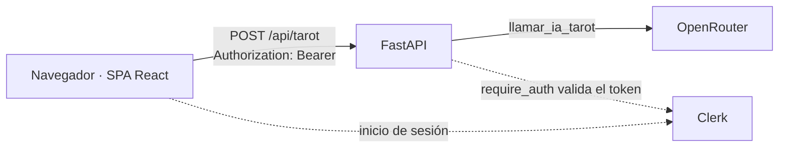

# ESPA · Práctica 1 — Oráculo Astral: tarot con IA desplegado en Vercel y AWS EC2

Miniapp de tarot con IA: el consultante rellena un formulario (sus datos y su pregunta), el servidor saca tres Arcanos Mayores y un modelo de OpenRouter escribe la lectura. Se despliega de dos formas: serverless en Vercel (Parte 1) y en un contenedor Docker sobre AWS EC2 (Parte 2), con autenticación Clerk en ambas.

> Estado (2026-11-02): **Fases 0–6 hechas.** Vercel en producción con Clerk (§6, §7), contenedor verificado en local (§8) y **app funcionando en EC2** (§9). Pendientes: completar los datos de la instancia en §9, los tags de los hitos, las capturas de `evidencias/` y la Fase 7 (cierre y defensa). Los huecos por rellenar están marcados con **[completar]**.

## 1. Identificación

| Persona | Rol | Aportación |
| --- | --- | --- |
| Pablo | A · Tests y seguridad | Fase 1: `api/test_api.py` (6 tests del contrato, proveedor simulado) y comprobación de que no se filtran detalles del proveedor; Fase 2: `requirements.txt` con versiones fijadas y tabla de variables completada; Fase 4: validación del token de Clerk en FastAPI (`require_auth`) y tests de rechazo sin token y de aceptación con verificador simulado; Fase 5: `Dockerfile` multi-stage, `docker_app.py`, `.dockerignore` y verificación local del contenedor (§1, §4, §5, §7, §8, §10, §12) |
| Javier | B · Frontend y Vercel (integrador) | Fase 0: scaffold del proyecto, flujo Git y README esqueleto; Fase 2: SPA React (`src/App.tsx`: formulario, carga, error y resultado) y proxy de Vite; Fase 3: `vercel.json`, `.vercelignore` y despliegue con la CLI; Fase 4: Clerk en la SPA (`ClerkProvider`, inicio/cierre de sesión, token en `Authorization`); paso de Resumidor a Oráculo Astral (`POST /api/tarot`, formulario de consulta, carta personal y arcano del año, animación de barajado) (§3, §4, §6, §7, §10, §11, §12); integración de las ramas en `dev` y `main` |
| Nicolas | C · Backend, infra y AWS | Fase 1: backend FastAPI en `api/index.py` (`GET /api/health`, `POST /api/generar` validado 1–2000, `llamar_ia` aislada con timeout de 20 s y errores 502/504 sin trazas); verificación real en §10, corrección de `AI_MODEL` en §11 e integración de las ramas de Fase 1 en `dev`; Fase 5: verificación del contenedor con Clerk (rechazo `401`, logs, parada/arranque, `--restart unless-stopped`), procedencia de la imagen y procedimiento de actualización (§8, §11, §12); Fase 6: instancia EC2, Docker, Security Group (SSH 22 solo desde nuestras IP con `/32` y HTTP 80) y contenedor en marcha (§9); datos concretos de la instancia **[completar]** |

- Práctica: UD1 · Explotación y despliegue de una aplicación con IA.
- Miniapp: **Oráculo Astral** (formulario de consulta → tres cartas al azar + lectura de la IA). Hasta la Fase 3 fue un **Resumidor** (texto → resumen); las verificaciones de esas fases en §6 y §10 se refieren a él y a `POST /api/generar`, que sigue existiendo y también está protegido.
- Las aportaciones individuales se pueden comprobar en `git log --format='%an %s'` (los merges no son squash).

## 2. Plan de documentación

- **Lector:** alguien con conocimientos de Docker y cloud que quiere reproducir el despliegue sin hablar con nosotros.
- **Estructura:** las 12 secciones del enunciado en un único README; capturas en `evidencias/` con nombre `fase-N_que-demuestra.png`.
- **Reparto:** documentamos todos. Cada uno escribe lo que hace en la sección que corresponda, en la rama de la tarea que documenta.
- **Actualización:** por hitos. Cada fase deja su sección escrita antes de mergear a `dev`; no se reconstruye al final.
- **Guía consultada:** [Diátaxis](https://diataxis.fr/) (separar instrucciones, referencia y explicación).

## 3. Arquitectura



Recorrido de una lectura:

1. La SPA solo enseña el formulario con sesión de Clerk. Al enviarlo pide el token de sesión (`getToken()`) y llama a `POST /api/tarot` en **el mismo origen**: sin CORS.
2. FastAPI ejecuta la dependencia `require_auth`, que valida el token con el SDK de Clerk (firma, caducidad y `authorized_parties`). Si falla, responde `401` y no llama a la IA.
3. Pydantic valida la consulta (`422` si algo no cuadra). El servidor saca tres cartas al azar (`random.sample`) y calcula el signo, la carta personal y el arcano del año a partir de la fecha.
4. `llamar_ia_tarot` llama a OpenRouter (API compatible con OpenAI, timeout de 20 s) con la clave del servidor. La respuesta es JSON con el signo, las cartas y la lectura; los errores del proveedor se convierten en `502`/`504` genéricos.

| | Vercel (Parte 1) | EC2 + Docker (Parte 2) |
| --- | --- | --- |
| SPA | estáticos de `dist/` servidos por Vercel | `dist/` servido por FastAPI (`StaticFiles` en `docker_app.py`) |
| API | `api/index.py` como función serverless Python (se arranca por petición, con límite de duración) | uvicorn como proceso permanente dentro de un único contenedor |
| `/api/*` | *rewrite* de `vercel.json` a la función | rutas de FastAPI, montadas antes de los estáticos |
| Secretos | variables de entorno del proyecto Vercel | `~/espa.env` privado (`chmod 600`) pasado con `--env-file` |
| HTTPS | sí (el de Vercel) | no: HTTP en el puerto 80 (limitación aceptada para la demo, §9) |
| Operación | `vercel deploy`, `vercel logs` | `docker ps/logs/restart`, `--restart unless-stopped` |

## 4. Requisitos e instalación local

Versiones con las que se ha creado el proyecto:

| Herramienta | Versión |
| --- | --- |
| Node.js | 26.11 |
| pnpm | 11.28 |
| Python | 3.14 (local); 3.12 en el contenedor |
| Vite / React / TypeScript | 8.3 / 19.2 / 6.0 |
| Tailwind CSS | 4.3 (plugin `@tailwindcss/vite`) |
| Clerk (frontend) | `@clerk/react` 6.17 |
| pytest · httpx | 9.1.1 · 0.28.1 (tests del contrato de la API) |

Las dependencias de Python están **fijadas con `==` en `requirements.txt`** (Fase 2) para que el mismo código instale lo mismo en local, en Vercel y en la imagen de Docker. Para actualizar una versión: `pip install -U <paquete>`, comprobar `pytest -q` y cambiar la línea correspondiente.

Frontend:

```bash
pnpm install
cp .env.example .env     # rellenar a mano
pnpm dev                 # http://localhost:5173
pnpm build               # comprobación: debe terminar sin errores
```

Backend (Fase 1):

```bash
python -m venv .venv && source .venv/bin/activate   # fish: activate.fish
pip install -r requirements.txt
uvicorn api.index:app --reload --port 8000
```

Tests (Python 3.14 local, `pytest` + `httpx` instalados con `pip install -r requirements.txt`):

```bash
pytest -q        # 22 passed en ~0.7 s
```

- Los tests viven en `api/test_api.py` y solo usan el contrato de la API: el proveedor se simula con `monkeypatch` sobre `api.index.llamar_ia` y `api.index.llamar_ia_tarot`, y Clerk sobre `api.index.authenticate_request`. No hay llamadas a OpenRouter ni a Clerk.
- `httpx` es obligatorio: es el transporte que usa `fastapi.testclient.TestClient`.

Para probar la app completa en local hacen falta **dos terminales**: el backend en `:8000` y `pnpm dev` en `:5173`. Vite reenvía `/api/*` a `http://localhost:8000` (`server.proxy` en `vite.config.ts`), así que el navegador usa un único origen y no hace falta CORS. Comprobación: ver §10 «Frontend mínimo».

## 5. Variables de entorno

| Variable | Finalidad | Pública/Secreta | Dónde se configura | Momento de uso | Fase |
| --- | --- | --- | --- | --- | --- |
| `AI_API_KEY` | Clave de OpenRouter | Secreta | `.env` local · Vercel env · archivo privado en EC2 | **Ejecución** (arranque del proceso) | 1 |
| `AI_MODEL` | Modelo de OpenRouter (formato `proveedor/modelo`) | No secreta | igual | **Ejecución** | 1 |
| `CLERK_SECRET_KEY` | Validar sesiones en el backend | Secreta | igual | **Ejecución** | 4 |
| `CLERK_AUTHORIZED_PARTIES` | Orígenes permitidos, separados por coma | No secreta | igual | **Ejecución** | 4 |
| `VITE_CLERK_PUBLISHABLE_KEY` | Inicializar Clerk en la SPA | Pública | `.env` local · Vercel env · `--build-arg` en Docker | **Compilación** (se incrusta en el bundle JS) | 4 |

- El proveedor de IA es OpenRouter, que expone una API compatible con OpenAI (`https://openrouter.ai/api/v1`); el modelo va en variable, no en código. `.env.example` solo contiene nombres, nunca valores.
- **Quién lee cada variable:** el backend las toma con `os.getenv()` (cargadas localmente con `python-dotenv`); la SPA solo puede ver las `VITE_*`, que Vite sustituye durante `pnpm build`.
- **Cuándo hace efecto un cambio:** las de *ejecución* solo se leen al arrancar, así que cambiarlas en Vercel o en EC2 **no** afecta a despliegues ya hechos: hay que redesplegar o reiniciar el contenedor. La de *compilación* hay que volver a compilar (`vercel deploy --prod` o `docker build` de nuevo).
- **Para configurarlas sin filtrarlas:** en Vercel, `vercel env add <nombre> <entorno>` pide el valor por teclado (no queda en el historial); `vercel env ls` lista nombres y entornos, no valores. En EC2 van en `~/espa.env` con permisos `600`, fuera del repositorio.

## 6. Vercel

**Un único proyecto** (`espa-practica-1`) sirve la SPA y la API desde la raíz del repo:

| Pieza | Cómo la sirve Vercel |
| --- | --- |
| SPA | Framework **Vite**: `pnpm build` (`tsc -b && vite build`) genera `dist/`, que se publica como estático |
| API | `api/index.py` es una función serverless de Python (FastAPI, `app` de nivel de módulo); sus dependencias salen de `requirements.txt` |
| Rutas | `rewrites` de `vercel.json`: `/api/(.*)` → `/api/index.py`; FastAPI resuelve `/api/health`, `/api/tarot` y `/api/generar` con sus propias rutas |

`vercel.json` fija `framework`, `buildCommand`, `outputDirectory` y el *rewrite*; `.vercelignore` deja fuera del despliegue `api/test_api.py` (Vercel lo trataría como una segunda función y no tiene `app`), `docker_app.py`, `Dockerfile` y `plan/`. Las variables de entorno se añaden con `vercel env add` (§5) y **no** están en el repositorio. No hay CORS: SPA y API comparten origen.

Comandos de la Fase 3 (el dueño del proyecto es Javier; los de otras personas se hacen en sesión conjunta con `Co-authored-by`):

```bash
vercel link                 # crea/enlaza el proyecto en la raíz (deja .vercel/, ignorado por Git)
vercel deploy               # Preview
vercel deploy --prod        # producción
```

Despliegue (2026-10-19, proyecto `espa-practica-1`, repo conectado a GitHub): **https://espa-practica-1.vercel.app**

| Comando | Finalidad | Resultado |
| --- | --- | --- |
| `vercel link` | Crear el proyecto y enlazar la carpeta | Proyecto creado; deja `.vercel/` y `.env.local` (ambos ignorados). Detecta Vite y respeta `vercel.json` |
| `vercel deploy` | Despliegue de prueba | `Ready` en ~1 min. Es el primero del proyecto, así que Vercel lo asigna a producción |
| `vercel deploy --prod` | Publicar en producción | `Ready` en ~54 s; el alias `espa-practica-1.vercel.app` apunta al nuevo despliegue |
| `vercel logs --since 30m` | Ver logs de la función | Dos peticiones `POST /api/generar` con `HTTP/1.1 200 OK` desde OpenRouter, `runtime: python3.12` |

Verificación contra el alias de producción:

| Petición | Resultado |
| --- | --- |
| `GET /` | `200`, HTML de la SPA con `/assets/index-*.js` |
| `GET /api/health` | `200 {"status":"ok"}` |
| `POST /api/generar` con texto válido | `200 {"resumen":"…"}` (resumen real, ~38 s la primera vez con el modelo gratuito) |
| `POST /api/generar` con `texto` vacío | `422` |

**Ramas y despliegues:** la rama de producción del proyecto es `main` (comprobado con `vercel api /v9/projects/<id>`, campo `link.productionBranch`), así que producción solo cambia al integrar `dev` en `main` en un hito. Para que cada push a `dev` no genere un despliegue de preview, `vercel.json` lleva `"git": {"deploymentEnabled": {"dev": false}}`; los despliegues manuales (`vercel deploy`) siguen funcionando.

**Deployment Protection:** está activa (Vercel Authentication) para las URLs propias de cada despliegue (`espa-practica-1-<hash>-<equipo>.vercel.app` responde `302` al login de Vercel), pero **no** para el alias de producción, que es público. Las comprobaciones con `curl` y las evidencias de rechazo se hacen siempre contra el alias.

**Variables de entorno** (`vercel env ls`, 2026-11-02; la CLI muestra nombres y entornos, nunca los valores):

| Variable | Tipo en Vercel | Entorno |
| --- | --- | --- |
| `AI_API_KEY` | Secret | Production |
| `AI_MODEL` | Config | Production |
| `CLERK_SECRET_KEY` | Secret | Production |
| `CLERK_AUTHORIZED_PARTIES` | Secret | Production |
| `VITE_CLERK_PUBLISHABLE_KEY` | Config | Production |

Solo están en **Production**: los previews no tienen claves, así que un preview no puede llamar a la IA ni validar sesiones. `VITE_CLERK_PUBLISHABLE_KEY` es de compilación, de modo que cambiarla exige un despliegue nuevo, no basta con reiniciar.

**Redespliegue con Clerk (Fase 4).** Producción se construye desde `main`; al integrar `dev` (Clerk + tarot) en `main`, Vercel volvió a desplegar. Comprobación contra el alias de producción (2026-11-02):

| Petición | Resultado |
| --- | --- |
| `GET /` | `200`, HTML de la SPA |
| `GET /api/health` | `200 {"status":"ok"}` (público) |
| `POST /api/tarot` sin `Authorization` | `401 {"detail":"No autenticado"}` |
| `POST /api/tarot` con `Authorization: Bearer abc.def.ghi` | `401 {"detail":"No autenticado"}` |
| `POST /api/generar` sin `Authorization` | `401 {"detail":"No autenticado"}` |
| Inicio de sesión con una cuenta de prueba y una tirada | **[completar: lectura recibida y `vercel logs` con `POST /api/tarot 200`]** |

_Pendiente: capturas del proyecto y de las variables en Vercel (sin valores) en `evidencias/`._

## 7. Clerk

- **Entorno:** instancia de **desarrollo** de Clerk (claves `pk_test_…`/`sk_test_…`) con cuentas de prueba, como permite el enunciado. La etiqueta *Production* de Vercel no la convierte en una instancia de producción.
- **Frontend** (`src/main.tsx`, `src/App.tsx`): `ClerkProvider` con `VITE_CLERK_PUBLISHABLE_KEY`; si falta, la app falla al arrancar con un error explícito. `SignInButton`/`SignUpButton` (modales) y `UserButton` para cerrar sesión. Con `<Show when="signed-in">` el formulario solo se enseña con sesión, y cada petición lleva `Authorization: Bearer <getToken()>`.
- **Backend** (`api/index.py`): la dependencia `require_auth` llama a `authenticate_request` de `clerk-backend-api` con `CLERK_SECRET_KEY`, `authorized_parties` (de `CLERK_AUTHORIZED_PARTIES`) y `accepts_token=["session_token"]`. El SDK comprueba la firma del JWT, su caducidad y que el `azp` sea uno de nuestros orígenes. Se aplica a `/api/tarot` y `/api/generar`; `/api/health` queda público porque no revela nada.
- **Orígenes autorizados** (`CLERK_AUTHORIZED_PARTIES`, separados por coma): `http://localhost:5173` en desarrollo, `http://localhost:8000` en el contenedor local, `https://espa-practica-1.vercel.app` en Vercel y `http://IP_EC2` en AWS. Cada entorno tiene el suyo en su propia configuración.
- **Ocultar el formulario no protege la API.** La prueba es una petición directa sin token:

```bash
curl -i -X POST https://espa-practica-1.vercel.app/api/tarot \
  -H 'content-type: application/json' \
  -d '{"nombre":"Prueba","fecha":"2000-01-01","tema":"general","pregunta":"¿Qué debo saber?","marco":"presente"}'
# HTTP/2 401  {"detail":"No autenticado"}
```

Lleva un cuerpo válido a propósito: así el `401` viene de la autenticación y no de la validación (`422`). El mismo rechazo está comprobado en el contenedor local (§8) y en EC2 (§9), y en los tests `test_generar_rejects_request_without_token` y `test_tarot_rejects_request_without_token`.

## 8. Docker

Un **único contenedor multi-stage** (`Dockerfile` en la rama `build/a-dockerfile`): la etapa `web` (Node 22 + pnpm) compila la SPA y la etapa final (Python 3.12-slim) instala `requirements.txt` y sirve la API y `dist/` con `uvicorn docker_app:app` en el **puerto 8000**. `docker_app.py` monta `StaticFiles(directory="dist", html=True)` en `/` **después** de las rutas de la API; se llama así (y no `app.py`) para que Vercel no lo tome como entrypoint.

`.dockerignore` excluye del contexto de build: `.git`, `node_modules`, `dist`, `.venv`, `.env`/`.env.*` (menos `.env.example`), `.vercel`, `*.pem`, `evidencias`, `plan`, `__pycache__` y `.pytest_cache`. Ningún secreto entra en la imagen: la única clave que se inyecta es `VITE_CLERK_PUBLISHABLE_KEY` como `ARG` de build (pública) y los secretos se inyectan al **ejecutar** con `--env-file`.

Comprobación local (2026-10-19, imagen `espa-p1:dev` construida desde `dev`):

```bash
docker build --build-arg VITE_CLERK_PUBLISHABLE_KEY=pk_test_… -t espa-p1:dev .
docker run -d --name espa -p 8000:8000 espa-p1:dev
docker ps
docker logs --tail 50 espa
curl -s localhost:8000/api/health
docker stop espa && docker start espa
docker history espa-p1:dev
```

| Comando | Resultado |
| --- | --- |
| `docker build … -t espa-p1:dev .` | `Successfully tagged espa-p1:dev` (pnpm install --frozen-lockfile + pnpm build, y pip con versiones fijadas) |
| `docker run -d --name espa -p 8000:8000 espa-p1:dev` | contenedor `Up`, `0.0.0.0:8000->8000/tcp` |
| `GET http://localhost:8000/api/health` | `200 {"status":"ok"}` |
| `GET http://localhost:8000/` | HTML de la SPA (`dist/index.html` con sus `/assets/index-*.js`) |
| `POST http://localhost:8000/api/generar` sin token | `502` (el contenedor no lleva `AI_API_KEY`; el `401` de FastAPI llega con la Fase 4) |
| `docker logs --tail 8 espa` | arranque de uvicorn, peticiones y `Error del proveedor de IA: OpenAIError` (solo el tipo de excepción, sin claves) |
| `docker stop espa && docker start espa` | `running` tras el reinicio y `GET /api/health` → `200` |
| `docker history espa-p1:dev` | sin secretos: la búsqueda de prefijos de claves de API, IDs de AWS y claves privadas no devuelve resultados |

### Verificación con autenticación (2026-11-02, rama `docs/c-docker-verification`)

La imagen se reconstruye con la clave publicable real y el contenedor se arranca con el `.env` completo. `CLERK_AUTHORIZED_PARTIES` debe incluir el origen desde el que se abre la SPA (`http://localhost:8000`), que no está en el `.env` de desarrollo (`:5173`); se añade con `-e`, que prevalece sobre `--env-file`:

```bash
set -a && . ./.env && set +a
docker build --build-arg VITE_CLERK_PUBLISHABLE_KEY="$VITE_CLERK_PUBLISHABLE_KEY" -t espa-p1:dev -t espa-p1:$(git rev-parse --short HEAD) .
docker run -d --name espa --restart unless-stopped -p 8000:8000 \
  --env-file .env -e CLERK_AUTHORIZED_PARTIES="$CLERK_AUTHORIZED_PARTIES,http://localhost:8000" \
  espa-p1:dev
```

| Comprobación | Resultado |
| --- | --- |
| `docker ps` | un solo contenedor `espa` (`espa-p1:dev`), `Up`, `0.0.0.0:8000->8000/tcp` |
| `GET /api/health` | `200 {"status":"ok"}` (público) |
| `GET /` en navegador headless (Chromium) | la SPA renderiza («Iniciar sesión» / «Registrarse»), sin errores de consola |
| `POST /api/generar` y `/api/tarot` **sin** `Authorization` | `401 {"detail":"No autenticado"}` (lo devuelve FastAPI, no Vercel) |
| `POST /api/generar` con `Authorization: Bearer abc.def.ghi` | `401 {"detail":"No autenticado"}` (firma inválida) |
| Inicio de sesión en `http://localhost:8000` con una cuenta de prueba de Clerk y una lectura de tarot | `docker logs espa` muestra `POST /api/tarot … 200 OK`: el token de sesión llega a FastAPI y se valida dentro del contenedor |
| `docker stop espa` y `docker start espa` | `exited` → `running`; con el contenedor parado el puerto no responde (`000`) y tras `start` `GET /api/health` → `200` |
| `docker inspect -f '{{.HostConfig.RestartPolicy.Name}}' espa` y `docker restart espa` | `unless-stopped`; tras el reinicio `GET /api/health` → `200` |
| `docker logs --tail 12 espa` | arranque de uvicorn y una línea por petición (`200`, `401`); nunca el cuerpo, el token ni las claves |
| `docker history --no-trunc espa-p1:dev` + búsqueda de `sk-`, `sk_test_`/`sk_live_`, `BEGIN … PRIVATE KEY` y `AKIA` | 0 coincidencias |
| `grep -rlF "$AI_API_KEY"` sobre el sistema de ficheros de la imagen | 0 ficheros; tampoco hay ningún `.env*` dentro de la imagen |

El `ENV` de la imagen final solo contiene variables de la imagen base de Python; la clave publicable (pública por diseño) solo queda en el bundle de `dist/`. El aviso de `docker build` `SecretsUsedInArgOrEnv` sobre `VITE_CLERK_PUBLISHABLE_KEY` es un falso positivo por el nombre: es la clave publicable `pk_test_…`, que acaba en el JS que descarga cualquier navegador, y la etapa `web` no forma parte de la imagen final.

### Procedencia de la imagen y actualización

**Qué versión es cada imagen.** Cada imagen se etiqueta con el hash corto del commit con el que se construyó (`espa-p1:f494c36`) y, al cerrar el hito, con el tag de Git (`espa-p1:v0.5-docker`, y `espa-p1:v1.0-aws` para la versión desplegada en EC2). Como el repositorio no guarda imágenes, el vínculo es el nombre de la etiqueta: `docker ps --format '{{.Image}}'` dice qué versión corre y `git show <tag>` o `git show <sha>` qué código contiene. La imagen se construye siempre desde un checkout limpio de ese commit (la etapa `web` copia el árbol de trabajo entero, salvo lo excluido en `.dockerignore`).

**Cómo llega la imagen a EC2.** Se construye en local (la máquina de desarrollo y una EC2 `t3.*` son ambas `linux/amd64`, así que la imagen sirve tal cual) y se traslada como archivo, sin registro de imágenes. Los secretos viajan aparte, en un `.env.ec2` propio (ignorado por Git y por `.dockerignore`) con `CLERK_AUTHORIZED_PARTIES` apuntando a `http://IP_EC2`:

```bash
# En local
docker save espa-p1:<sha> | gzip > espa-p1-<sha>.tar.gz
scp -i <clave.pem> espa-p1-<sha>.tar.gz .env.ec2 ubuntu@IP_EC2:~

# En EC2
mv .env.ec2 espa.env && chmod 600 espa.env
gunzip -c espa-p1-<sha>.tar.gz | docker load
docker run -d --name espa --restart unless-stopped -p 80:8000 --env-file ~/espa.env espa-p1:<sha>
curl -s localhost/api/health && docker logs --tail 20 espa
```

Alternativa si la instancia tiene memoria de sobra: `git clone` + `git checkout <tag>` + `docker build` directamente en EC2.

**Actualizar a una versión nueva** (también cuando solo cambian variables de entorno):

```bash
git fetch --tags && git checkout <tag>
docker build --build-arg VITE_CLERK_PUBLISHABLE_KEY=<pk_test_…> -t espa-p1:<tag> .
# subir a EC2 como arriba y, allí:
docker stop espa && docker rm espa
docker run -d --name espa --restart unless-stopped -p 80:8000 --env-file ~/espa.env espa-p1:<tag>
curl -s localhost/api/health && docker logs --tail 20 espa
```

- `docker restart` **no** relee `--env-file`: las variables se fijan al crear el contenedor, así que un cambio en `.env` exige `stop` + `rm` + `run`.
- Cambiar la clave publicable de Clerk obliga a reconstruir la imagen (es de compilación, §5).
- **Vuelta atrás:** volver a crear el contenedor con la etiqueta anterior (`espa-p1:<tag_anterior>`); las imágenes antiguas siguen en el host hasta que se borren con `docker image rm`.
- La secuencia de parar, recrear y comprobar se ha ejecutado en local (con `-p 8000:8000`) y es la que se usa en EC2, con `-p 80:8000` (§9).

La ejecución en EC2 (mapeo `80:8000`, `CLERK_AUTHORIZED_PARTIES` con `http://IP_EC2`) está en §9. El tag formal `v0.5-docker` se crea sobre `main` cuando estén integradas las tres ramas de la Fase 5.

## 9. AWS

La aplicación **ya funciona en EC2** dentro de **un único contenedor**: la misma imagen que en §8, trasladada con `docker save` / `docker load` (sin registro de imágenes) y etiquetada con el hash del commit. Los secretos están en `~/espa.env` (permisos `600`, fuera de Git).

| Dato | Valor |
| --- | --- |
| Región | **[completar]** |
| Sistema operativo (AMI) | **[completar]** (p. ej. Ubuntu 24.04 LTS) |
| Tipo de instancia | **[completar]** (p. ej. `t3.micro`) |
| IP pública / URL | `http://`**[completar]** |
| Imagen desplegada | `espa-p1:`**[completar: sha o tag]** (commit **[completar]**) |
| Fecha del despliegue | **[completar]** |

**Security Group (reglas de entrada):**

| Protocolo | Puerto | Origen | Para qué |
| --- | --- | --- | --- |
| TCP | 22 (SSH) | **[completar: IP de cada integrante con /32]** | administración |
| TCP | 80 (HTTP) | **[completar: `0.0.0.0/0` o la red del centro]** | la aplicación |

No hay ninguna otra regla: ni el 8000 (solo existe dentro del host) ni el socket de Docker (`2375/2376`) están expuestos. La clave `.pem` se guarda fuera del repositorio con permisos `400` (`*.pem` también está en `.dockerignore`).

**Puesta en marcha** (el detalle del traslado de la imagen está en §8):

```bash
# En la instancia
sudo apt-get update && sudo apt-get install -y docker.io      # o el paquete de la distro elegida
sudo usermod -aG docker $USER                                  # y volver a entrar por SSH
docker version
gunzip -c espa-p1-<sha>.tar.gz | docker load
mv .env.ec2 espa.env && chmod 600 espa.env                     # CLERK_AUTHORIZED_PARTIES=http://IP_EC2
docker run -d --name espa --restart unless-stopped -p 80:8000 --env-file ~/espa.env espa-p1:<sha>
```

**Verificación desde fuera de la instancia:**

| Comprobación | Resultado |
| --- | --- |
| `docker ps` en EC2 | **[completar]** (un solo contenedor `espa`, `0.0.0.0:80->8000/tcp`) |
| `curl http://IP_EC2/api/health` desde el portátil | **[completar]** (`200 {"status":"ok"}`) |
| Navegador en `http://IP_EC2`: inicio de sesión, tirada y cierre de sesión | **[completar]** |
| `POST http://IP_EC2/api/tarot` sin token (mismo `curl` que en §7) | **[completar]** (`401 {"detail":"No autenticado"}`) |
| `docker logs --tail 20 espa` | **[completar]** (una línea por petición, sin tokens ni claves) |
| `docker restart espa` y nueva comprobación | **[completar]** |
| `ls -l ~/espa.env` | **[completar]** (`-rw-------`, sin mostrar su contenido) |

**Limitación de HTTP.** En EC2 no hay HTTPS: el token de sesión de Clerk y los datos del formulario viajan sin cifrar. Es aceptable en una demo docente con cuentas y datos de prueba; en un despliegue real habría que poner un dominio con certificado (o un proxy TLS) delante. La autenticación **no** se desactiva: `http://IP_EC2` está en `CLERK_AUTHORIZED_PARTIES`. **[completar: si Clerk o el navegador pusieron alguna pega con el origen HTTP y cómo se resolvió]**

**Actualización y reinicio:** el procedimiento está en §8 («Actualizar a una versión nueva»). Si la IP pública cambia al parar y arrancar la instancia, hay que actualizar la URL de este README y `CLERK_AUTHORIZED_PARTIES` en `~/espa.env` de EC2, y recrear el contenedor (`docker restart` no relee `--env-file`).

**Costes y retirada:** la instancia corre en el Learner Lab de AWS Academy (consume los créditos del laboratorio; la IA usa un modelo gratuito de OpenRouter). Después de la defensa se termina la instancia y se eliminan los recursos asociados (volumen EBS, IP elástica si la hubiera, Security Group y par de claves), y se revocan las claves de OpenRouter y Clerk usadas en la práctica.

## 10. Operación y verificación

### Oráculo Astral (estado actual)

`POST /api/tarot` recibe la consulta y devuelve JSON:

| Campo de entrada | Validación |
| --- | --- |
| `nombre` | obligatorio, 1–40 caracteres (se recortan espacios) |
| `fecha` | obligatoria, entre 1900-01-01 y hoy |
| `hora` | opcional (`HH:MM`) |
| `tema` | uno de: amor, trabajo, dinero, salud, desarrollo personal, familia, decisiones, general |
| `pregunta` | obligatoria, 5–300 caracteres |
| `contexto` | opcional, hasta 500 caracteres |
| `marco` | uno de: presente, próximas semanas, 3 meses, 1 año |
| `persona` | opcional, hasta 60 caracteres |

Respuesta: `signo`, `carta_personal` y `arcano_anio` (numerología: día + mes + año de nacimiento, o del año actual, reduciendo dígitos hasta 1–22, con el 22 = El Loco), `cartas` (pasado, presente y futuro, al azar en el servidor) y `lectura` (4 párrafos). Los límites de longitud acotan el consumo de IA, y el prompt pide al modelo que trate los campos de texto libre como datos y no como instrucciones.

En la SPA, mientras llega la respuesta, se muestra un overlay de barajado hecho solo con CSS (respeta `prefers-reduced-motion`). Los errores siguen el mismo esquema que en la Fase 2: el `detail` del backend para 502/504, un mensaje fijo para 422 y «No se pudo conectar con el servidor» si no hay red.

Tests actuales (`pytest -q` → `22 passed`):

| Test | Qué comprueba |
| --- | --- |
| `test_health_is_public_and_ok` | `/api/health` → `200` sin token |
| `test_generar_rejects_request_without_token` · `test_tarot_rejects_request_without_token` | sin `Authorization` → `401 {"detail":"No autenticado"}` |
| `test_generar_accepts_request_with_valid_token` · `test_tarot_accepts_request_with_valid_token` | con token válido (verificador simulado) → `200` |
| `test_tarot_happy_path_with_mocked_provider` | signo, carta personal, tres cartas distintas en orden pasado/presente/futuro, y la consulta llega al proveedor |
| `test_arcano_de_reduces_to_major_arcana` | numerología de la carta personal (incluido el caso 22 → El Loco) |
| `test_tarot_rejects_invalid_input` | 9 casos → `422` (sin fecha, formato inválido, < 1900, futura, nombre vacío, tema y marco fuera de lista, sin pregunta, contexto largo) |
| `test_tarot_returns_generic_502_on_provider_failure` | error del proveedor → `502` sin filtrar el mensaje interno |
| tests de `generar` de la Fase 1 | siguen en verde (ver más abajo) |

### Backend mínimo (Fase 1)

Arranque local del backend (usa `api/index.py`; las variables se cargan de `.env` con `python-dotenv`):

```bash
python -m venv .venv && source .venv/bin/activate   # fish: activate.fish
pip install -r requirements.txt
uvicorn api.index:app --reload --port 8000
```

Comprobaciones ejecutadas (2026-10-19, contra el modelo real de OpenRouter configurado en `.env`):

| Comando | Resultado |
| --- | --- |
| `GET /api/health` | `200 {"status":"ok"}` |
| `POST /api/generar` con `{"texto":""}` | `422` (validación Pydantic, 1–2000) |
| `POST /api/generar` con 2001 caracteres | `422` (validación Pydantic) |
| `POST /api/generar` con texto válido | `200 {"resumen":"…"}` (resumen real) |
| `POST /api/generar` con `AI_API_KEY` inválida | `502 {"detail":"El servicio de IA no está disponible"}` |

Ejemplo de llamada:

```bash
curl -s localhost:8000/api/health
curl -s -X POST localhost:8000/api/generar \
  -H 'content-type: application/json' \
  -d '{"texto":"Texto de prueba largo suficiente para resumir."}'
```

Errores del proveedor: `502` genérico (sin trazas ni claves en la respuesta ni en logs) y `504` si se supera el timeout de 20 s.

### Tests del contrato (Fase 1, rama `test/a-backend-tests`; estado de entonces)

```bash
pytest -q
```

| Test | Qué comprueba | Resultado |
| --- | --- | --- |
| `test_health_is_public_and_ok` | `GET /api/health` → `200 {"status":"ok"}` | pass |
| `test_generar_happy_path_with_mocked_provider` | `POST /api/generar` con texto válido → `200 {"resumen":…}` (proveedor simulado) | pass |
| `test_generar_rejects_invalid_input` | `texto` vacío y `texto` de 2001 caracteres → `422` | pass (2 casos parametrizados) |
| `test_generar_returns_generic_502_on_provider_failure` | El proveedor lanza error → `502` con mensaje genérico y sin detalle filtrado | pass |
| `test_generar_returns_504_on_provider_timeout` | El proveedor supera el timeout → `504` | pass |

```
6 passed in 0.37s
```

Todos los tests son de contrato: se hace `monkeypatch.setattr("api.index.llamar_ia", …)` y no se realiza ninguna llamada real. El test de `502` comprueba además que el mensaje interno del proveedor no aparece en la respuesta.

### Frontend mínimo (Fase 2, rama `feat/b-spa`)

`src/App.tsx` es un único componente con `useState` (sin router, sin store, sin librerías de UI): textarea limitado a 2000 caracteres con contador, botón «Resumir» (deshabilitado si está vacío o mientras carga), mensaje de error (`role="alert"`) y tarjeta con el resumen. Los errores se muestran con el `detail` del backend (502 y 504); un 422 se traduce a un mensaje fijo porque ahí `detail` es una lista de Pydantic; si no hay conexión se muestra «No se pudo conectar con el servidor».

Comprobaciones ejecutadas (2026-10-19, backend con `uvicorn` en `:8000` y `pnpm dev` en `:5173`, siempre pasando por el proxy de Vite):

| Comando | Resultado |
| --- | --- |
| `pnpm build` · `pnpm lint` | sin errores |
| `GET localhost:5173/api/health` | `200 {"status":"ok"}` (llega al backend a través del proxy) |
| `POST localhost:5173/api/generar` con texto válido | `200 {"resumen":"…"}` (resumen real) |
| `POST localhost:5173/api/generar` con `texto` vacío | `422` |
| `POST localhost:5173/api/generar` con `AI_MODEL` inexistente | `502 {"detail":"El servicio de IA no está disponible"}` (la SPA lo muestra como error) |

## 11. Problemas y soluciones

| Fase | Síntoma | Diagnóstico | Solución | Comprobación |
| --- | --- | --- | --- | --- |
| 0 | `pnpm create vite .` se cancela en un repo con archivos | Vite pide directorio vacío | Generar el scaffold en una carpeta temporal y copiarlo sin pisar `.gitignore` ni `README.md` | `pnpm build` y `pnpm install --frozen-lockfile` en limpio |
| 0 | `@clerk/clerk-react` aparece como deprecado | Clerk lo renombró a `@clerk/react` en Core 3 | Usar `@clerk/react` | `pnpm view @clerk/clerk-react deprecated` |
| 1 | `POST /api/generar` devuelve `502` y el log muestra `NotFoundError` | El modelo de `AI_MODEL` no existe en OpenRouter (`No endpoints found for <modelo>`) | Cambiar `AI_MODEL` a un modelo válido y disponible (`nvidia/nemotron-3.5-lightning:free`) | `POST /api/generar` con texto válido devuelve `200` y resumen real |
| 2 | `pnpm build` falla con `exec: node: no encontrado` aunque `pnpm` funciona | `pnpm` se instaló como binario independiente y no trae Node; `tsc` y `vite` lo necesitan | Instalar Node (el 24 LTS vale; en Arch `sudo pacman -S nodejs`) | `node -v` y `pnpm build` terminan bien |
| 2 | `POST /api/generar` da `502` con el log `NotFoundError` en un `.env` heredado | El `AI_MODEL` local apuntaba a un modelo que ya no existe en OpenRouter (mismo síntoma que en Fase 1) | Cambiar `AI_MODEL` en `.env` y reiniciar `uvicorn`: `load_dotenv()` solo lee el archivo al arrancar | `POST /api/generar` devuelve `200` con resumen |
| 3 | `vercel link` termina con `Failed to connect Itsj5j6j7/ESPA-practica-1 to project` | La app de GitHub de Vercel no tenía acceso al repositorio | En GitHub → Settings → Applications → Vercel → Configure, dar acceso al repo y conectarlo en Project → Settings → Git | El proyecto muestra el repo conectado; `vercel deploy` no depende de esta conexión |
| 3 | `vercel link` añade `.vercel` y `.env*` al `.gitignore` | La CLI lo hace sin mirar las reglas existentes; `.env*` volvería a ignorar `.env.example` | Descartar el cambio: `.vercel/` y `.env.*` (con `!.env.example`) ya estaban | `git check-ignore -v .env.local .vercel/project.json` los cubre y `.env.example` sigue versionado |
| 5 | `docker version` → `permission denied while trying to connect to the docker API` | El usuario no pertenecía al grupo `docker` (el daemon estaba instalado y parado) | `sudo systemctl start docker` y `sudo usermod -aG docker $USER` + abrir una sesión nueva | `docker version --format '{{.Server.Version}}'` → `29.9.0` |
| 5 | La SPA servida por el contenedor sale en blanco y la consola dice `Falta VITE_CLERK_PUBLISHABLE_KEY` | La imagen se construyó con la variable vacía (`.env` sin rellenar): Vite incrusta `VITE_*` en el bundle **al compilar**, así que pasarla luego con `--env-file` no sirve | Rellenar la clave en `.env` y volver a ejecutar `docker build --build-arg VITE_CLERK_PUBLISHABLE_KEY="$VITE_CLERK_PUBLISHABLE_KEY" …`; recrear el contenedor | La SPA muestra «Iniciar sesión» / «Registrarse» y la consola no tiene errores |
| 5 | `docker build` falla en `pnpm install --frozen-lockfile` con `getaddrinfo EAI_AGAIN registry.npmjs.org` | Fallo transitorio de DNS dentro de la build (el host y el contenedor resuelven bien al repetirlo) | Repetir el `docker build`; las capas ya descartadas se recuperan del cache | `docker build` termina con `Successfully tagged espa-p1:dev` |

## 12. Git y evidencias

- **Ramas:** `main` (solo hitos, lleva los tags) ← `dev` (integración) ← ramas de tarea `<tipo>/<tema>` creadas desde `dev`.
- **Integración:** Javier (dueño del proyecto Vercel) mergea las ramas a `dev` con merge commit (`--no-ff`), nunca squash, para conservar la autoría de cada commit. En la Fase 1, Nicolas integró sus dos ramas en `dev` con `--no-ff` y Pablo integra la suya de la misma forma.
- **Commits:** Conventional Commits (`tipo(scope opcional): descripción`), en español, en imperativo y sin punto final. Los anteriores a la Fase 5 están en inglés y no se reescriben.

| Hito | Rama | Contenido |
| --- | --- | --- |
| Fase 0 | `chore/gitignore-env-example` | `.gitignore` y `.env.example` |
| Fase 0 | `build/scaffold-vite-react` | Scaffold Vite + React + TypeScript |
| Fase 0 | `build/tailwind-clerk-deps` | Tailwind 4 y `@clerk/react` |
| Fase 0 | `build/python-requirements` | `requirements.txt` inicial |
| Fase 0 | `docs/readme-skeleton` | Este README con las 12 secciones |
| Fase 0 | `docs/team-plan` | `plan/` con el plan de trabajo y la guía de fases |
| Fase 1 | `feat/c-generar-endpoint` | `api/index.py`: `health`, `generar`, validación y errores 502/504 (Nicolas) |
| Fase 1 | `docs/c-fase1-backend` | Verificación con el modelo real y arreglo de `AI_MODEL` (§10 y §11) (Nicolas) |
| Fase 1 | `test/a-backend-tests` | `api/test_api.py` (6 tests de contrato) y documentación en §1, §4, §10 y §12 (Pablo) |
| Fase 2 | `chore/a-reproducible-deps` | `requirements.txt` con versiones fijadas y tabla de variables de entorno completada (§4 y §5) (Pablo) |
| Fase 2 | `feat/b-spa` | `src/App.tsx` (formulario, carga y error) y proxy `/api` en `vite.config.ts` + documentación en §1, §4, §10 y §11 (Javier) |
| Fase 3 | `build/b-vercel-config` | `vercel.json` (Vite + rewrite `/api/*`), `.vercelignore` y documentación en §6 (Javier) |
| Fase 3 | `docs/b-vercel-deploy` | `vercel link/deploy/deploy --prod` ejecutados y verificación de producción en §6 y §11 (Javier) |
| Fase 4 | commits en `dev` | `feat: add tarot reading page with ai interpretation` · `feat(web): require clerk sign-in to use the tarot form` (Javier) |
| Fase 4 | commits en `dev` | `feat: validate clerk session token in fastapi dependency` · `test: reject requests without token on protected endpoints` · `test: accept requests with valid token using mocked verifier` (Pablo) |
| Fase 4 | commits en `dev` | `feat(tarot): add consultation fields and shuffle animation` (Javier) |
| Fase 5 | `build/a-dockerfile` | `Dockerfile` multi-stage, `docker_app.py` y `.dockerignore` + verificación local del contenedor (§8) (Pablo) |
| Fase 5 | `docs/c-docker-verification` | Verificación local con autenticación, logs, parada/arranque y política de reinicio; procedencia de la imagen y procedimiento de actualización (§8 y §11) (Nicolas) |
| Fase 6 | **[completar: rama]** | instancia EC2, Security Group, Docker y contenedor en marcha; §9 (Nicolas) |

_Tags (`v0.1-backend` … `v1.0-aws`), release con las dos URLs y capturas en `evidencias/`: pendientes._
