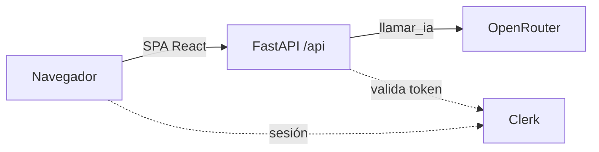

# ESPA · Práctica 1 — Resumidor con IA desplegado en Vercel y AWS EC2

Miniapp que resume un texto con IA. Se despliega de dos formas: serverless en Vercel (Parte 1) y en un contenedor Docker sobre AWS EC2 (Parte 2), con autenticación Clerk en ambas.

> Estado: **Fase 0 completada** (scaffold del frontend) y **Fase 1 en curso**: backend de Nicolas integrado en `dev`, tests de Pablo en `test/a-backend-tests`. Las secciones marcadas _Pendiente_ se rellenan en la fase indicada, en la misma rama que el cambio que documentan.

## 1. Identificación

| Persona | Rol | Aportación |
| --- | --- | --- |
| Pablo | A · Tests y seguridad | Fase 1: `api/test_api.py` (6 tests del contrato, proveedor simulado) y comprobación de que no se filtran detalles del proveedor; Fase 2: `requirements.txt` con versiones fijadas y tabla de variables completada (§1, §4, §5, §10, §12); _resto pendiente_ |
| Javier | B · Frontend y Vercel (integrador) | Scaffold del proyecto, flujo Git y README esqueleto; _resto pendiente_ |
| Nicolas | C · Backend, infra y AWS | Fase 1: backend FastAPI en `api/index.py` (`GET /api/health`, `POST /api/generar` validado 1–2000, `llamar_ia` aislada con timeout de 20 s y errores 502/504 sin trazas); verificación real en §10, corrección de `AI_MODEL` en §11 e integración de las ramas de Fase 1 en `dev`; _resto pendiente_ |

- Práctica: UD1 · Explotación y despliegue de una aplicación con IA.
- Miniapp: **Resumidor** (texto de 1 a 2000 caracteres → resumen breve).
- Las aportaciones individuales se pueden comprobar en `git log --format='%an %s'` (los merges no son squash).

## 2. Plan de documentación

- **Lector:** alguien con conocimientos de Docker y cloud que quiere reproducir el despliegue sin hablar con nosotros.
- **Estructura:** las 12 secciones del enunciado en un único README; capturas en `evidencias/` con nombre `fase-N_que-demuestra.png`.
- **Reparto:** documentamos todos. Cada uno escribe lo que hace en la sección que corresponda, en la rama de la tarea que documenta.
- **Actualización:** por hitos. Cada fase deja su sección escrita antes de mergear a `dev`; no se reconstruye al final.
- **Guía consultada:** [Diátaxis](https://diataxis.fr/) (separar instrucciones, referencia y explicación).

## 3. Arquitectura

_Pendiente (Fase 2–3)._ Esquema previsto:



- Vercel: SPA estática + función serverless Python en `api/index.py`.
- EC2: un único contenedor; FastAPI sirve la API y `dist/`.

## 4. Requisitos e instalación local

Versiones con las que se ha creado el proyecto:

| Herramienta | Versión |
| --- | --- |
| Node.js | 26.11 |
| pnpm | 11.28 |
| Python | 3.14 (local); 3.12 en el contenedor |
| Vite / React / TypeScript | 8.3 / 19.2 / 6.0 |
| Tailwind CSS | 4.3 (plugin `@tailwindcss/vite`) |
| Clerk (frontend) | `@clerk/react` 6.17 |
| pytest · httpx | 9.1.1 · 0.28.1 (tests del contrato de la API) |

Las dependencias de Python están **fijadas con `==` en `requirements.txt`** (Fase 2) para que el mismo código instale lo mismo en local, en Vercel y en la imagen de Docker. Para actualizar una versión: `pip install -U <paquete>`, comprobar `pytest -q` y cambiar la línea correspondiente.

Frontend:

```bash
pnpm install
cp .env.example .env     # rellenar a mano
pnpm dev                 # http://localhost:5173
pnpm build               # comprobación: debe terminar sin errores
```

Backend (Fase 1):

```bash
python -m venv .venv && source .venv/bin/activate   # fish: activate.fish
pip install -r requirements.txt
uvicorn api.index:app --reload --port 8000
```

Tests (Python 3.14 local, `pytest` + `httpx` instalados con `pip install -r requirements.txt`):

```bash
pytest -q        # 6 passed en ~0.4 s
```

- Los tests viven en `api/test_api.py` y solo usan el contrato de la API: el proveedor se simula con `monkeypatch` sobre `api.index.llamar_ia`, sin llamadas a OpenRouter ni a Clerk.
- `httpx` es obligatorio: es el transporte que usa `fastapi.testclient.TestClient`.

_Comprobación de extremo a extremo: pendiente (Fase 2)._

## 5. Variables de entorno

| Variable | Finalidad | Pública/Secreta | Dónde se configura | Momento de uso | Fase |
| --- | --- | --- | --- | --- | --- |
| `AI_API_KEY` | Clave de OpenRouter | Secreta | `.env` local · Vercel env · archivo privado en EC2 | **Ejecución** (arranque del proceso) | 1 |
| `AI_MODEL` | Modelo de OpenRouter (formato `proveedor/modelo`) | No secreta | igual | **Ejecución** | 1 |
| `CLERK_SECRET_KEY` | Validar sesiones en el backend | Secreta | igual | **Ejecución** | 4 |
| `CLERK_AUTHORIZED_PARTIES` | Orígenes permitidos, separados por coma | No secreta | igual | **Ejecución** | 4 |
| `VITE_CLERK_PUBLISHABLE_KEY` | Inicializar Clerk en la SPA | Pública | `.env` local · Vercel env · `--build-arg` en Docker | **Compilación** (se incrusta en el bundle JS) | 4 |

- El proveedor de IA es OpenRouter, que expone una API compatible con OpenAI (`https://openrouter.ai/api/v1`); el modelo va en variable, no en código. `.env.example` solo contiene nombres, nunca valores.
- **Quién lee cada variable:** el backend las toma con `os.getenv()` (cargadas localmente con `python-dotenv`); la SPA solo puede ver las `VITE_*`, que Vite sustituye durante `pnpm build`.
- **Cuándo hace efecto un cambio:** las de *ejecución* solo se leen al arrancar, así que cambiarlas en Vercel o en EC2 **no** afecta a despliegues ya hechos: hay que redesplegar o reiniciar el contenedor. La de *compilación* hay que volver a compilar (`vercel deploy --prod` o `docker build` de nuevo).
- **Para configurarlas sin filtrarlas:** en Vercel, `vercel env add <nombre> <entorno>` pide el valor por teclado (no queda en el historial); `vercel env ls` lista nombres y entornos, no valores. En EC2 van en `~/espa.env` con permisos `600`, fuera del repositorio.

## 6. Vercel

_Pendiente (Fase 3)._

## 7. Clerk

_Pendiente (Fase 4)._

## 8. Docker

_Pendiente (Fase 5)._

## 9. AWS

_Pendiente (Fase 2 y 6)._

## 10. Operación y verificación

### Backend mínimo (Fase 1)

Arranque local del backend (usa `api/index.py`; las variables se cargan de `.env` con `python-dotenv`):

```bash
python -m venv .venv && source .venv/bin/activate   # fish: activate.fish
pip install -r requirements.txt
uvicorn api.index:app --reload --port 8000
```

Comprobaciones ejecutadas (2026-10-19, contra el modelo real de OpenRouter configurado en `.env`):

| Comando | Resultado |
| --- | --- |
| `GET /api/health` | `200 {"status":"ok"}` |
| `POST /api/generar` con `{"texto":""}` | `422` (validación Pydantic, 1–2000) |
| `POST /api/generar` con 2001 caracteres | `422` (validación Pydantic) |
| `POST /api/generar` con texto válido | `200 {"resumen":"…"}` (resumen real) |
| `POST /api/generar` con `AI_API_KEY` inválida | `502 {"detail":"El servicio de IA no está disponible"}` |

Ejemplo de llamada:

```bash
curl -s localhost:8000/api/health
curl -s -X POST localhost:8000/api/generar \
  -H 'content-type: application/json' \
  -d '{"texto":"Texto de prueba largo suficiente para resumir."}'
```

Errores del proveedor: `502` genérico (sin trazas ni claves en la respuesta ni en logs) y `504` si se supera el timeout de 20 s.

### Tests del contrato (Fase 1, rama `test/a-backend-tests`)

```bash
pytest -q
```

| Test | Qué comprueba | Resultado |
| --- | --- | --- |
| `test_health_is_public_and_ok` | `GET /api/health` → `200 {"status":"ok"}` | pass |
| `test_generar_happy_path_with_mocked_provider` | `POST /api/generar` con texto válido → `200 {"resumen":…}` (proveedor simulado) | pass |
| `test_generar_rejects_invalid_input` | `texto` vacío y `texto` de 2001 caracteres → `422` | pass (2 casos parametrizados) |
| `test_generar_returns_generic_502_on_provider_failure` | El proveedor lanza error → `502` con mensaje genérico y sin detalle filtrado | pass |
| `test_generar_returns_504_on_provider_timeout` | El proveedor supera el timeout → `504` | pass |

```
6 passed in 0.37s
```

Todos los tests son de contrato: se hace `monkeypatch.setattr("api.index.llamar_ia", …)` y no se realiza ninguna llamada real. El test de `502` comprueba además que el mensaje interno del proveedor no aparece en la respuesta.

## 11. Problemas y soluciones

| Fase | Síntoma | Diagnóstico | Solución | Comprobación |
| --- | --- | --- | --- | --- |
| 0 | `pnpm create vite .` se cancela en un repo con archivos | Vite pide directorio vacío | Generar el scaffold en una carpeta temporal y copiarlo sin pisar `.gitignore` ni `README.md` | `pnpm build` y `pnpm install --frozen-lockfile` en limpio |
| 0 | `@clerk/clerk-react` aparece como deprecado | Clerk lo renombró a `@clerk/react` en Core 3 | Usar `@clerk/react` | `pnpm view @clerk/clerk-react deprecated` |
| 1 | `POST /api/generar` devuelve `502` y el log muestra `NotFoundError` | El modelo de `AI_MODEL` no existe en OpenRouter (`No endpoints found for <modelo>`) | Cambiar `AI_MODEL` a un modelo válido y disponible (`nvidia/nemotron-3.5-lightning:free`) | `POST /api/generar` con texto válido devuelve `200` y resumen real |

## 12. Git y evidencias

- **Ramas:** `main` (solo hitos, lleva los tags) ← `dev` (integración) ← ramas de tarea `<tipo>/<tema>` creadas desde `dev`.
- **Integración:** Javier (dueño del proyecto Vercel) mergea las ramas a `dev` con merge commit (`--no-ff`), nunca squash, para conservar la autoría de cada commit. En la Fase 1, Nicolas integró sus dos ramas en `dev` con `--no-ff` y Pablo integra la suya de la misma forma.
- **Commits:** Conventional Commits, en inglés, minúsculas e imperativo.

| Hito | Rama | Contenido |
| --- | --- | --- |
| Fase 0 | `chore/gitignore-env-example` | `.gitignore` y `.env.example` |
| Fase 0 | `build/scaffold-vite-react` | Scaffold Vite + React + TypeScript |
| Fase 0 | `build/tailwind-clerk-deps` | Tailwind 4 y `@clerk/react` |
| Fase 0 | `build/python-requirements` | `requirements.txt` inicial |
| Fase 0 | `docs/readme-skeleton` | Este README con las 12 secciones |
| Fase 0 | `docs/team-plan` | `plan/` con el plan de trabajo y la guía de fases |
| Fase 1 | `feat/c-generar-endpoint` | `api/index.py`: `health`, `generar`, validación y errores 502/504 (Nicolas) |
| Fase 1 | `docs/c-fase1-backend` | Verificación con el modelo real y arreglo de `AI_MODEL` (§10 y §11) (Nicolas) |
| Fase 1 | `test/a-backend-tests` | `api/test_api.py` (6 tests de contrato) y documentación en §1, §4, §10 y §12 (Pablo) |
| Fase 2 | `chore/a-reproducible-deps` | `requirements.txt` con versiones fijadas y tabla de variables de entorno completada (§4 y §5) (Pablo) |

_Tags, releases y capturas: pendientes._
