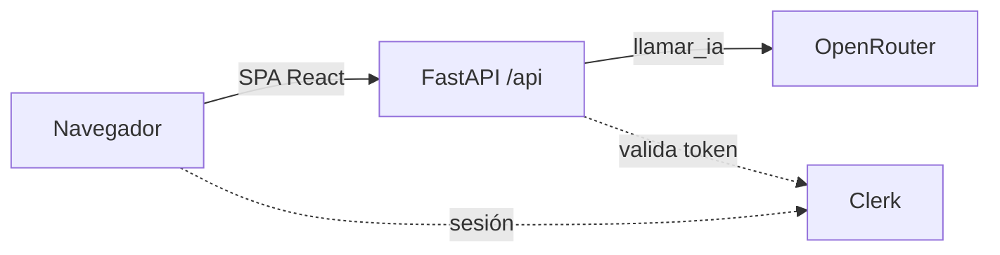

# ESPA · Práctica 1 — Resumidor con IA desplegado en Vercel y AWS EC2

Miniapp que resume un texto con IA. Se despliega de dos formas: serverless en Vercel (Parte 1) y en un contenedor Docker sobre AWS EC2 (Parte 2), con autenticación Clerk en ambas.

> Estado: **Fase 0 completada** (scaffold del frontend). Las secciones marcadas _Pendiente_ se rellenan en la fase indicada, en la misma rama que el cambio que documentan.

## 1. Identificación

| Persona | Rol | Aportación |
| --- | --- | --- |
| _(nombre)_ | A · Backend y seguridad | _Pendiente_ |
| _(nombre)_ | B · Frontend y Vercel | _Pendiente_ |
| _(nombre)_ | C · Tests, infra, AWS y docs | _Pendiente_ |

- Práctica: UD1 · Explotación y despliegue de una aplicación con IA.
- Miniapp: **Resumidor** (texto de 1 a 2000 caracteres → resumen breve).
- Las aportaciones individuales se pueden comprobar en `git log --format='%an %s'` (los merges no son squash).

## 2. Plan de documentación

- **Lector:** alguien con conocimientos de Docker y cloud que quiere reproducir el despliegue sin hablar con nosotros.
- **Estructura:** las 12 secciones del enunciado en un único README; capturas en `evidencias/` con nombre `fase-N_que-demuestra.png`.
- **Reparto:** cada sección tiene responsable (ver cabecera de cada una) y solo lo edita esa persona, en la rama de la tarea que documenta.
- **Actualización:** por hitos. Cada fase deja su sección escrita antes de mergear a `dev`; no se reconstruye al final.
- **Guía consultada:** [Diátaxis](https://diataxis.fr/) (separar instrucciones, referencia y explicación).

## 3. Arquitectura

<!-- responsable: B -->

_Pendiente (Fase 2–3)._ Esquema previsto:



- Vercel: SPA estática + función serverless Python en `api/index.py`.
- EC2: un único contenedor; FastAPI sirve la API y `dist/`.

## 4. Requisitos e instalación local

<!-- responsable: B -->

Versiones con las que se ha creado el proyecto:

| Herramienta | Versión |
| --- | --- |
| Node.js | 26.11 |
| pnpm | 11.28 |
| Python | 3.14 (local); 3.12 en el contenedor |
| Vite / React / TypeScript | 8.3 / 19.2 / 6.0 |
| Tailwind CSS | 4.3 (plugin `@tailwindcss/vite`) |
| Clerk (frontend) | `@clerk/react` 6.17 |

Frontend:

```bash
pnpm install
cp .env.example .env     # rellenar a mano
pnpm dev                 # http://localhost:5173
pnpm build               # comprobación: debe terminar sin errores
```

Backend (Fase 1):

```bash
python -m venv .venv && source .venv/bin/activate   # fish: activate.fish
pip install -r requirements.txt
uvicorn api.index:app --reload --port 8000
```

_Comprobación de extremo a extremo: pendiente (Fase 2)._

## 5. Variables de entorno

<!-- responsable: A -->

| Variable | Finalidad | Pública/Secreta | Dónde se configura | Momento de uso |
| --- | --- | --- | --- | --- |
| `AI_API_KEY` | Clave de OpenRouter | Secreta | `.env` local · Vercel env · archivo privado en EC2 | Ejecución |
| `AI_MODEL` | Modelo de OpenRouter (formato `proveedor/modelo`) | No secreta | igual | Ejecución |
| `CLERK_SECRET_KEY` | Validar sesiones en el backend | Secreta | igual | Ejecución |
| `CLERK_AUTHORIZED_PARTIES` | Orígenes permitidos, separados por coma | No secreta | igual | Ejecución |
| `VITE_CLERK_PUBLISHABLE_KEY` | Inicializar Clerk en la SPA | Pública | `.env` local · Vercel env · `--build-arg` en Docker | **Compilación** |

El proveedor de IA es OpenRouter, que expone una API compatible con OpenAI (`https://openrouter.ai/api/v1`); el modelo va en variable, no en código. `.env.example` solo contiene nombres, nunca valores.

## 6. Vercel

<!-- responsable: B -->

_Pendiente (Fase 3)._

## 7. Clerk

<!-- responsable: A -->

_Pendiente (Fase 4)._

## 8. Docker

<!-- responsable: C -->

_Pendiente (Fase 5)._

## 9. AWS

<!-- responsable: C -->

_Pendiente (Fase 2 y 6)._

## 10. Operación y verificación

<!-- responsable: A -->

_Pendiente (Fase 1 en adelante)._

## 11. Problemas y soluciones

<!-- responsable: C -->

| Fase | Síntoma | Diagnóstico | Solución | Comprobación |
| --- | --- | --- | --- | --- |
| 0 | `pnpm create vite .` se cancela en un repo con archivos | Vite pide directorio vacío | Generar el scaffold en una carpeta temporal y copiarlo sin pisar `.gitignore` ni `README.md` | `pnpm build` y `pnpm install --frozen-lockfile` en limpio |
| 0 | `@clerk/clerk-react` aparece como deprecado | Clerk lo renombró a `@clerk/react` en Core 3 | Usar `@clerk/react` | `pnpm view @clerk/clerk-react deprecated` |

## 12. Git y evidencias

<!-- responsable: C -->

- **Ramas:** `main` (solo hitos, lleva los tags) ← `dev` (integración) ← ramas de tarea `<tipo>/<tema>` creadas desde `dev`.
- **Integración:** el dueño del proyecto Vercel mergea las ramas a `dev` con merge commit (`--no-ff`), nunca squash, para conservar la autoría de cada commit.
- **Commits:** Conventional Commits, en inglés, minúsculas e imperativo.

| Hito | Rama | Contenido |
| --- | --- | --- |
| Fase 0 | `chore/gitignore-env-example` | `.gitignore` y `.env.example` |
| Fase 0 | `build/scaffold-vite-react` | Scaffold Vite + React + TypeScript |
| Fase 0 | `build/tailwind-clerk-deps` | Tailwind 4 y `@clerk/react` |
| Fase 0 | `build/python-requirements` | `requirements.txt` inicial |
| Fase 0 | `docs/readme-skeleton` | Este README con las 12 secciones |
| Fase 0 | `docs/team-plan` | `plan/` con el plan de trabajo y la guía de fases |

_Tags, releases y capturas: pendientes._
